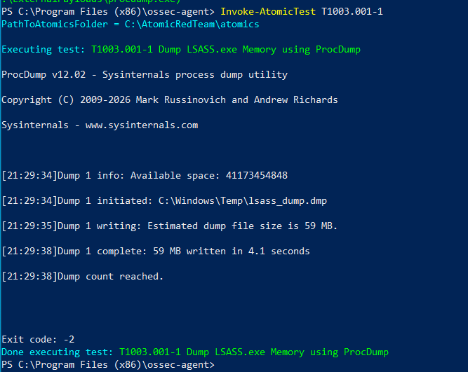
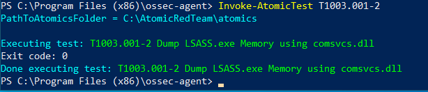
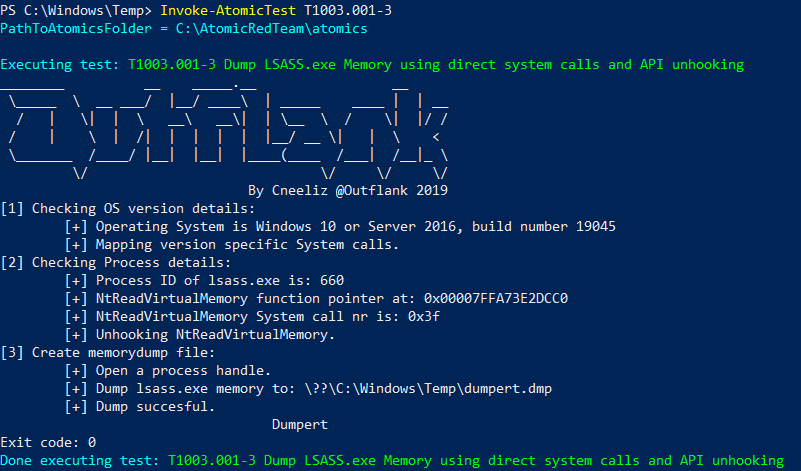
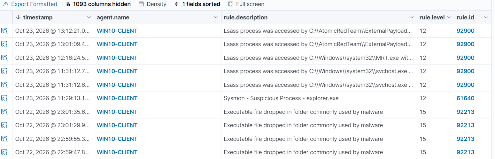

#  Home SOC Lab: Analiza Telemetrii i Inżynieria Detekcji w Wazuh SIEM


##  1. Cel projektu 
Celem projektu było zaprojektowanie, wdrożenie oraz przetestowanie środowiska **Security Operations Center (SOC)** w warunkach laboratoryjnych. Projekt odzwierciedla pełny cykl pracy analityka SOC Tier 1 oraz Detection Engineera:
1. Zbudowanie architektury zbierania logów z podatnej aplikacji webowej (**OWASP Juice Shop**) oraz stacji roboczej (**Windows 10** z Sysmonem).
2. Przeprowadzenie kontrolowanych symulacji ataków webowych (SQLi, XSS, Path Traversal) oraz ataków na endpoint (OS Credential Dumping - LSASS) przy użyciu **Atomic Red Team**.
3. Analizę surowej telemetrii i identyfikację wskaźników kompromitacji (IoC).
4. Opracowanie własnych reguł detekcji w języku XML, korelacja zdarzeń oraz mapowanie logiki do matrycy **MITRE ATT&CK**.

---

##  2. Architektura Laboratorium

Środowisko zostało zwirtualizowane przy użyciu hiperwizora **VMware Workstation** i podzielone na segmenty:

| Komponent | System / Technologia | Rola w środowisku |
| :--- | :--- | :--- |
| **Wazuh Server (SIEM)** | Ubuntu Server (Docker Compose) | Centralny menedżer logów (`wazuh-manager`), silnik analityczny, indeksowanie oraz wizualizacja. |
| **Monitorowany Host Web** | Kali Linux (`kali-endpoint`) | Host uruchamiający cel ataków webowych – **OWASP Juice Shop** (Node.js / SQLite). |
| **Monitorowany Endpoint** | Windows 10 | Stacja robocza z wdrożonym systemem **Sysmon**, cel testów Atomic Red Team (kradzież poświadczeń). |

---

## 3. Konfiguracja potoku logów (Web & Endpoint)

### Logi aplikacyjne (Juice Shop / Kali):
Strumieniowanie wyjścia kontenera do dedykowanego pliku dziennika na hoście Kali Linux:
```bash
sudo su -
mkdir -p /var/log/juiceshop
docker logs -f juiceshop >> /var/log/juiceshop/access.log 2>&1 &
```
W pliku `ossec.conf` dodano monitorowanie (`<log_format>syslog</log_format>`).

### Logi endpointowe (Sysmon / Windows 10):
Zainstalowano agenta Wazuh oraz system Sysmon (z dedykowaną konfiguracją XML). W pliku `ossec.conf` na maszynie Windows zdefiniowano subskrypcję kanału zdarzeń:
```xml
<localfile>
  <location>Microsoft-Windows-Sysmon/Operational</location>
  <log_format>eventchannel</log_format>
</localfile>
```

---

##  4. Symulacja Ataku i Analiza Wskaźników (Web)

Przeprowadzono próbę manipulacji zapytaniem bazodanowym w endpoincie wyszukiwarki produktów za pomocą ładunku SQL Injection:
```bash
curl -s "http://localhost:3000/rest/products/search?q='''%20OR%201=1--" > /dev/null
```
Brak parametryzacji zapytania wywołał błąd wykonania silnika SQLite, zarejestrowany w strumieniu: `Error: SQLITE_ERROR: incomplete input`.

* **Widok z perspektywy atakującego (Kali Linux):**  
  

---

##  5. Inżynieria Detekcji (Reguły Customowe)

Wdrożono zestaw autorskich reguł w pliku `juiceshop_rules.xml`. Przykład dla korelacji zautomatyzowanego skanowania katalogów:

```xml
  <!-- DIRECTORY BRUTE-FORCE -->
  <rule id="100012" level="3">
    <match> 404 </match>
    <description>Juice Shop: Zasob nie zostal odnaleziony (HTTP 404)</description>
  </rule>

  <rule id="100013" level="10" frequency="8" timeframe="30">
    <if_matched_sid>100012</if_matched_sid>
    <description>Juice Shop: Wykryto automatyczne skanowanie katalogow (seria 404)</description>
    <mitre>
      <id>T1083</id>
    </mitre>
  </rule>
```
* **Widok reguł w Wazuh Dashboard:**  
  

---

##  6. Symulacja i Detekcja Kradzieży Poświadczeń (Windows LSASS)

W ramach testowania bezpieczeństwa stacji roboczej (Endpoint Security), wykorzystano framework **Atomic Red Team** do przeprowadzenia symulacji zrzutu pamięci procesu LSASS (Technika MITRE: **T1003.001**). Testy wykonano w systemie Windows 10 z zainstalowanym Sysmonem (Event ID 10 - ProcessAccess).

Wykonano trzy warianty ataku:

**Wariant 1: Użycie narzędzia ProcDump (T1003.001-1)**


**Wariant 2: Użycie systemowej biblioteki comsvcs.dll - LoLBin (T1003.001-2)**


**Wariant 3: Użycie bezpośrednich wywołań systemowych i unhookingu API (T1003.001-3)**


### Wynik Detekcji w Wazuh SIEM
Analiza w panelu *Threat Hunting* udowodniła, że Wazuh poprawnie interpretuje telemetrię z Sysmona. System zareagował alertami o **poziomie krytycznym (Level 12)** na podstawie potężnej, wbudowanej reguły `92900`, skutecznie flagując warianty oparte na zewnętrznych payloadach (np. ProcDump).

* **Detekcja dostępu do LSASS w panelu Wazuh:**  
  

---

##  7. Wizualizacja i Triage w Dashboardzie (Threat Hunting)

Zdarzenia napływające z agentów są na bieżąco korelowane i prezentowane w module *Threat Hunting*.
* **Zarejestrowane alerty w panelu Discover:**  
  
  

---

##  8. Napotkane problemy i Troubleshooting (Wnioski)

Podczas wdrażania napotkano na problemy, których rozwiązanie dostarczyło cennej wiedzy z zakresu działania systemów SIEM oraz EDR:

1. **Konflikty w silniku analitycznym (Nadpisywanie reguł):**
   * *Objaw:* Zdarzenia Sysmona z Windows 10 (Event ID 10) były błędnie klasyfikowane jako atak webowy *Path Traversal* dla Juice Shopu.
   * *Rozwiązanie:* Zdiagnozowano problem przy użyciu narzędzia `wazuh-logtest`. Okazało się, że zbyt ogólna reguła dla Juice Shopu (szukająca znaków `../` lub `\`) przechwytywała ścieżki systemowe Windowsa (np. `C:\Windows\System32\rundll32.exe`). Wymusiło to uszczegółowienie reguł webowych (dodanie tagów `<match>GET|POST</match>`), co przywróciło prawidłową klasyfikację logów z endpointów.

2. **Ciche blokowanie procesów (LoLBins vs EDR/Defender):**
   * *Objaw:* Wykonanie zrzutu pamięci wariantem drugim (`comsvcs.dll`) nie generowało alertów w SIEM, mimo prawidłowej składni reguł.
   * *Rozwiązanie:* Analiza wykazała, że ataki typu LoLBin (wykorzystujące natywne pliki systemu operacyjnego) są agresywniej monitorowane przez mechanizmy ochronne Windows Defender i EDR. Proces był zabijany u źródła tak szybko, że system operacyjny nie zdążył wypchnąć zdarzenia "ProcessAccess" do dziennika Sysmona. Udowadnia to różnicę między błędem detekcji SIEM a skuteczną, natywną prewencją endpointa.

3. **Problem z formatowaniem XML (Błąd `invalid token`):**
   * Zastąpiono znaki specjalne HTML (np. `<script`) uniwersalnymi wzorcami Regex, aby parser XML menedżera nie odrzucał reguł customowych.

---

##  9. Automatyzacja blokowania podejrzanych IP (Python)

W repozytorium dodano skrypt `wazuh_auto_block.py`, który:
1. Loguje się do API Wazuh.
2. Pobiera alerty i filtruje je po `rule.id` i oknie czasowym.
3. Wyszukuje źródłowe adresy IP.
4. Wywołuje **Active Response** do blokowania IP (lub działa w trybie dry-run).

### Szybki start
```bash
export WAZUH_BASE_URL="https://192.168.118.133:55000"
export WAZUH_USERNAME="wazuh-wui"
export WAZUH_PASSWORD="<HASLO_API>"

# Tryb bez zmian (podgląd)
python3 wazuh_auto_block.py --no-verify-ssl

# Realne blokowanie IP
python3 wazuh_auto_block.py --no-verify-ssl --execute-block
```