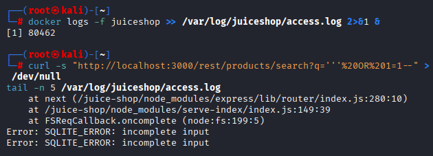
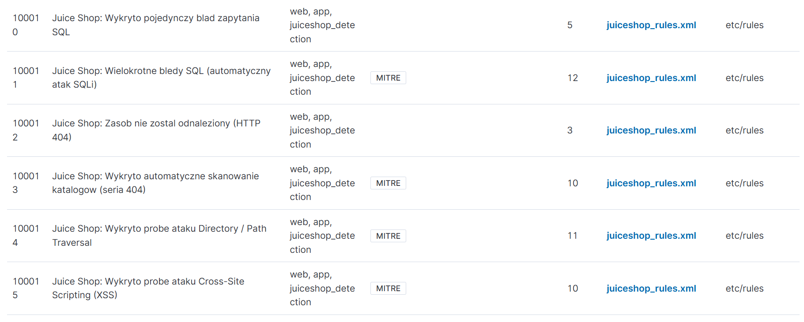
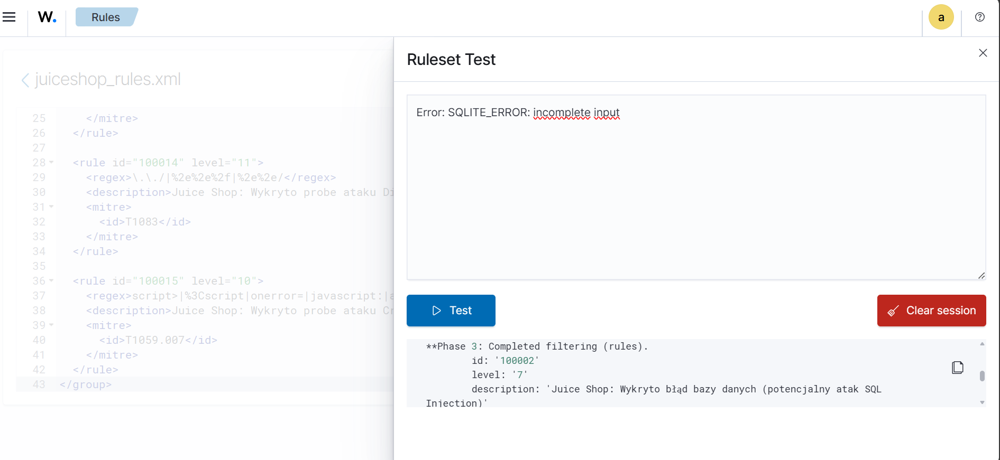
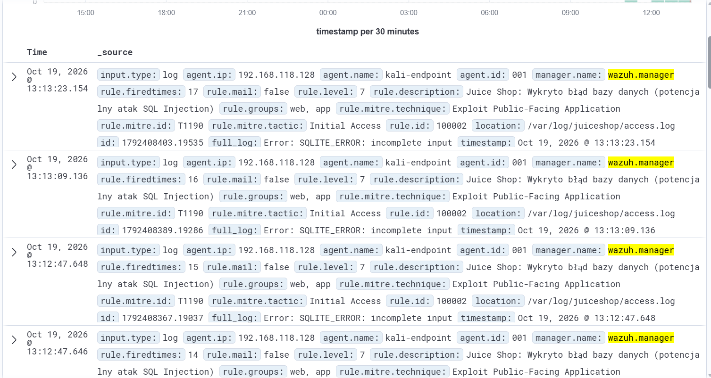
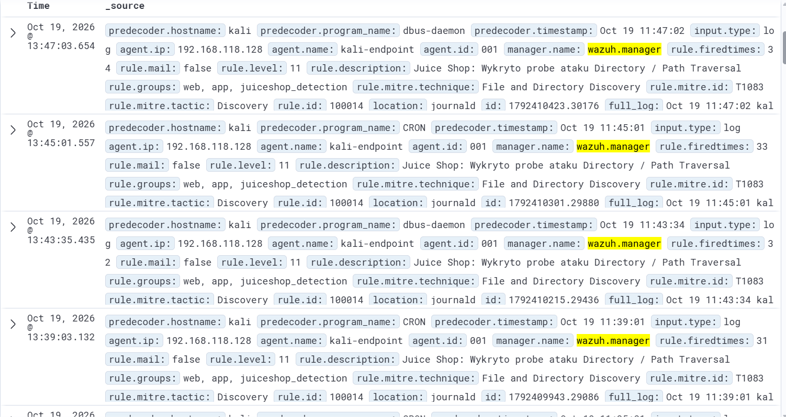

#  Home SOC Lab: Analiza Telemetrii i Inżynieria Detekcji w Wazuh SIEM


##  1. Cel projektu 
Celem projektu było zaprojektowanie, wdrożenie oraz przetestowanie środowiska **Security Operations Center (SOC)** w warunkach laboratoryjnych. Projekt odzwierciedla pełny cykl pracy analityka SOC Tier 1 oraz Detection Engineera:
1. Zbudowanie architektury zbierania logów z podatnej aplikacji webowej (**OWASP Juice Shop**) działającej w kontenerze Docker.
2. Przeprowadzenie kontrolowanych symulacji ataków webowych (**SQL Injection**, **Directory Brute-Force**, **Path Traversal**, **XSS**) z maszyny atakującego (Kali Linux).
3. Analizę surowej telemetrii i identyfikację wskaźników kompromitacji (IoC).
4. Opracowanie własnych reguł detekcji i korelacji czasowej w języku XML dla silnika **Wazuh SIEM** wraz z mapowaniem do matrycy **MITRE ATT&CK**.

---

##  2. Architektura Laboratorium

Środowisko zostało zwirtualizowane przy użyciu hiperwizora **VMware Workstation** i podzielone na dwa główne segmenty:

| Komponent | System / Technologia | Rola w środowisku |
| :--- | :--- | :--- |
| **Wazuh Server (SIEM)** | Ubuntu Server (Docker Compose) | Centralny menedżer logów (`wazuh-manager`), silnik analityczny, indeksowanie oraz wizualizacja w OpenSearch Dashboards. |
| **Monitorowany Host & Cel** | Kali Linux (`kali-endpoint`) | Host z zainstalowanym agentem Wazuh, na którym uruchomiono cel ataków – aplikację **OWASP Juice Shop** (Node.js / SQLite). |

### Przepływ telemetrii:
```text
[Atak z Kali Linux] ──> [Kontener Docker: OWASP Juice Shop] 
                              │
                              ▼ (Przekierowanie strumienia stdout/stderr)
                  [/var/log/juiceshop/access.log]
                              │
                              ▼ (Wazuh Agent: localfile syslog)
                  [Wazuh Manager: Analiza i Korelacja XML]
                              │
                              ▼ (Wazuh Indexer / OpenSearch)
                  [Alert w Dashboardzie SOC + MITRE Mapping]
```

---

## 3. Konfiguracja potoku logów

Aby zapewnić ciągłe przekazywanie zdarzeń z aplikacji OWASP Juice Shop do agenta Wazuh, skonfigurowano strumieniowanie wyjścia kontenera do dedykowanego pliku dziennika na hoście Kali Linux:

```bash
sudo su -
mkdir -p /var/log/juiceshop
docker logs -f juiceshop >> /var/log/juiceshop/access.log 2>&1 &
```

W pliku konfiguracyjnym agenta Wazuh (`/var/ossec/etc/ossec.conf`) zdefiniowano monitorowanie utworzonego pliku:

```xml
<localfile>
  <log_format>syslog</log_format>
  <location>/var/log/juiceshop/access.log</location>
</localfile>
```

---

##  4. Symulacja Ataku i Analiza Wskaźników

### Wektor ataku:
Przeprowadzono próbę manipulacji zapytaniem bazodanowym w endpoincie wyszukiwarki produktów za pomocą ładunku SQL Injection:

```bash
curl -s "http://localhost:3000/rest/products/search?q='''%20OR%201=1--" > /dev/null
```

### Analiza surowego logu (IoC):
Brak parametryzacji zapytania po stronie aplikacji wywołał błąd wykonania silnika bazy danych SQLite, który został zarejestrowany w strumieniu logów:
```text
Error: SQLITE_ERROR: incomplete input
```

* **Widok z perspektywy atakującego (Kali Linux):**  
  

---

##  5. Inżynieria Detekcji

W celu automatyzacji wykrywania zagrożeń i odróżnienia pojedynczych błędów od zautomatyzowanego skanowania, wdrożono zestaw autorskich reguł w pliku `/var/ossec/etc/rules/juiceshop_rules.xml` (przetestowanych i zweryfikowanych za pomocą wbudowanego modułu *Ruleset Test*).

### Zaimplementowane reguły detekcyjne:

```xml
<group name="web,app,juiceshop_detection">

  <!-- 1. SQL INJECTION (Pojedynczy błąd oraz korelacja czasowa) -->
  <rule id="100010" level="5">
    <match>SQLITE_ERROR</match>
    <description>Juice Shop: Wykryto pojedynczy blad zapytania SQL</description>
  </rule>

  <rule id="100011" level="12" frequency="5" timeframe="60">
    <if_matched_sid>100010</if_matched_sid>
    <description>Juice Shop: Wielokrotne bledy SQL (automatyczny atak SQLi)</description>
    <mitre>
      <id>T1190</id>
    </mitre>
  </rule>

  <!-- 2. DIRECTORY BRUTE-FORCE (Skanowanie zasobów - seria HTTP 404) -->
  <rule id="100012" level="3">
    <match> 404 </match>
    <description>Juice Shop: Zasob nie zostal odnaleziony (HTTP 404)</description>
  </rule>

  <rule id="100013" level="10" frequency="8" timeframe="30">
    <if_matched_sid>100012</if_matched_sid>
    <description>Juice Shop: Wykryto automatyczne skanowanie katalogow (seria 404)</description>
    <mitre>
      <id>T1083</id>
    </mitre>
  </rule>

  <!-- 3. PATH TRAVERSAL (Próba wyjścia poza katalog główny) -->
  <rule id="100014" level="11">
    <regex>\.\./|%2e%2e%2f|%2e%2e/</regex>
    <description>Juice Shop: Wykryto probe ataku Directory / Path Traversal</description>
    <mitre>
      <id>T1083</id>
    </mitre>
  </rule>

  <!-- 4. CROSS-SITE SCRIPTING (XSS) -->
  <rule id="100015" level="10">
    <regex>script>|%3Cscript|onerror=|javascript:|alert\(</regex>
    <description>Juice Shop: Wykryto probe ataku Cross-Site Scripting (XSS)</description>
    <mitre>
      <id>T1059.007</id>
    </mitre>
  </rule>

</group>
```

* **Widok reguł w Wazuh Dashboard:**  
  

* **Walidacja w module Ruleset Test:**  
  

---

##  6. Wizualizacja i Triage w Dashboardzie (Threat Hunting)

Zdarzenia napływające z agenta są na bieżąco korelowane i prezentowane w module *Threat Hunting* systemu Wazuh. 

* **Zarejestrowane alerty w panelu Discover:**  
  
  

* **Podsumowanie analityczne:**
  * Silnik pomyślnie wykrył próby wstrzykiwania kodu SQL, klasyfikując je do techniki **MITRE ATT&CK T1190** (*Exploit Public-Facing Application*).
  * Zastosowanie reguł korelacyjnych opartych na oknie czasowym (`timeframe` i `frequency`) skutecznie podnosi priorytet zdarzeń w przypadku wykrycia zautomatyzowanego skanowania.

---

##  7. Rekomendacje Naprawcze 
1. **AppSec:** Wdrożenie sparametryzowanych zapytań (*Prepared Statements*) w celu całkowitego wyeliminowania podatności SQL Injection w aplikacji.
2. **Network/WAF:** Skonfigurowanie zapory Web Application Firewall (WAF) do blokowania ciągów znaków charakterystycznych dla ataków XSS i Path Traversal na brzegu sieci.
3. **SIEM / SOAR:** Implementacja reguł automatycznej reakcji (*Active Response*) w Wazuh w celu blokowania adresów IP generujących serię incydentów o wysokim poziomie zagrożenia.

---

##  8. Napotkane problemy i Troubleshooting (Wnioski)

Podczas wdrażania i konfiguracji laboratoryjnej napotkano i rozwiązano następujące wyzwania techniczne:

1. **Problem ze strumieniowaniem logów z Dockera (`docker logs` w tle):**
   * *Objaw:* Proces uruchomiony z operatorem `&` oraz `sudo` zawieszał się ze statusem `suspended (tty input)`, ponieważ powłoka próbowała pytać o hasło w tle.
   * *Rozwiązanie:* Uruchomienie sesji uprzywilejowanej (`sudo su -`) przed zainicjowaniem potoku logów wyeliminowało problem interaktywnego promptu hasła i pozwoliło na stabilne przekierowanie strumienia do pliku `/var/log/juiceshop/access.log`.

2. **Błędy walidacji parsera XML w Wazuh Dashboard (Błąd `1113` / `invalid token`):**
   * *Objaw:* Webowy edytor reguł zgłaszał błąd składni przy użyciu encji specjalnych (np. `&lt;script`) wewnątrz znaczników `<regex>`.
   * *Rozwiązanie:* Dostosowano wyrażenia regularne (zastępując znaki mniejszości uniwersalnymi wzorcami końcowymi, np. `script>`), co umożliwiło pomyślne przejście walidacji API i zapisanie reguł bez naruszania struktury drzewa XML.
---
##  Wykorzystane kompetencje
* **SIEM & Log Management:** Wazuh, OpenSearch Dashboards, analiza logów surowych.
* **Detection Engineering:** Pisanie reguł XML, obsługa wyrażeń regularnych (Regex), korelacja zdarzeń, mapowanie MITRE ATT&CK.
* **Web Security:** Zrozumienie wektorów OWASP Top 10 (SQLi, XSS, Path Traversal, Brute-Force).
* **Infrastruktura:** Linux, Docker, VMware Workstation, SSH, testowanie reguł za pomocą CLI i interfejsu.

---

## 9. Automatyzacja blokowania podejrzanych IP (Python)

W repozytorium dodano skrypt `wazuh_auto_block.py`, który:
1. Loguje się do API Wazuh.
2. Pobiera alerty.
3. Filtruje je po `rule.id`, `rule.level` i oknie czasowym.
4. Wyszukuje źródłowe adresy IP.
5. Wywołuje **Active Response** do blokowania IP (lub działa w trybie dry-run).

### Szybki start

```bash
export WAZUH_BASE_URL="https://192.168.118.133:55000"
export WAZUH_USERNAME="wazuh-wui"
export WAZUH_PASSWORD="<HASLO_API>"

# Tryb bez zmian (podgląd)
python3 wazuh_auto_block.py --no-verify-ssl

# Realne blokowanie IP
python3 wazuh_auto_block.py --no-verify-ssl --execute-block
```

### Najważniejsze parametry

- `--rule-ids` (domyślnie: `100011,100013,100014,100015`)
- `--min-level` (domyślnie: `10`)
- `--lookback-minutes` (domyślnie: `15`)
- `--agent-id` (domyślnie: `001`)
- `--block-command` (domyślnie: `firewall-drop`)
- `--execute-block` (bez tej flagi skrypt działa jako dry-run)
